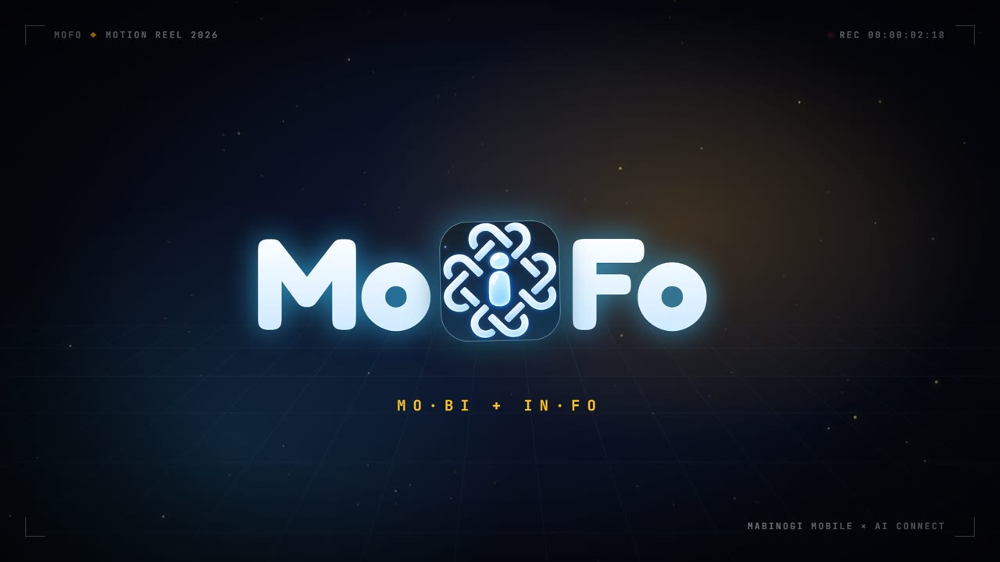

<div align="center">


# MoFo · 모포

**마비노기 모바일 정보 오버레이 (HUD)**

<sub><b>Mo</b>bi + In<b>Fo</b> — 게임은 그대로, 필요한 정보만 화면 위에.</sub>

<br>


**한국어** · [English](README.en.md)

</div>

---

## 🎬 소개 영상

<table>
  <tr>
    <td align="center" width="50%">
      <a href="docs/media/mofo-intro.mp4"></a>
      <br><b>▶ MoFo 소개</b> <sub>(15초)</sub>
    </td>
    <td align="center" width="50%">
      <a href="docs/media/mofo-song-finder.mp4"></a>
      <br><b>▶ NEW · 원곡 찾기</b> <sub>(22초)</sub>
    </td>
  </tr>
</table>

<sub>썸네일을 누르면 영상이 재생됩니다.</sub>

---

## ✨ 주요 기능

### 🕰️ 에린 타임
게임 속 에린 시각 · 날씨 · 현재 위치를 작은 배지로 항상 표시합니다.


### ⚒️ 가공 현황
가공 시설 6곳(금속 · 목재 · 가죽 · 옷감 · 약품 · 식재료)의 남은 시간을 실시간으로 카운트다운합니다. 완료되면 골드로 빛나고, **클릭 한 번으로 바로 수령**합니다. 2행 / 1행 레이아웃을 고를 수 있습니다.


### 📋 남은 미션
일일 · 주간 미션 중 아직 못 한 것만 모아 보여 줍니다.


### 🎵 미디어 리모컨
스포티파이 · YT뮤직 · 크롬 · 엣지 등 PC에서 재생 중인 음악을 게임을 떠나지 않고 조작합니다. 재생 / 일시정지 / 이전 / 다음 / 볼륨.


### 🎻 합주 방송 모션
근처에서 합주가 시작되면 같은 악보 연주자를 몇 초간 모았다가, 방송 자막처럼 **단 한 번** 우아하게 띄웁니다. 테마 4종을 고를 수 있습니다.


<details>
<summary>테마 4종 보기</summary>

| **시네마틱 골드** | **가시덩굴 개화** |
|:---:|:---:|
|  |  |
| **아케인 룬 마법** | **오로라 프리즘** |
|  |  |

</details>

### 🔎 원곡 찾기 <sup>NEW</sup>
악보를 골라 연주하면 악보 제목에서 `[합주용]`, `#피아노` 같은 주석을 걷어 내고 원곡을 찾아 냅니다. 확실한 결과일 때만 **채팅으로 자동 공유**합니다.
FLO · iTunes · Deezer 공개 검색을 쓰므로 **API 키가 필요 없고 비용도 들지 않습니다.**
설정 → **원곡 찾기 ON** 으로 켭니다.

### 🖱️ 게임 방해 없는 오버레이
- **스마트 관통**: 위젯만 클릭되고 빈 곳 클릭은 게임으로 그대로 통과합니다.
- **완전 관통 (F8)**: 위젯까지 모든 클릭을 게임으로 넘깁니다.
- 위젯 **더블클릭으로 5초 숨김**, 위치 이동 / 고정 / 초기화.
- 마비노기 창을 최소화하면 오버레이도 함께 숨고, 다시 띄우면 돌아옵니다.
- 시스템 트레이 아이콘으로 표시 / 숨김.

### ⚙️ 설정
레이아웃 프리셋 3개(실시간 자동 저장), UI 크기 75~200%, 위젯별 표시 토글, 합주 집계 시간, 자막 유지 시간 등을 조절합니다.


---

## 🚀 시작하기

### 필요한 것
- Windows 10 / 11 (WebView2 런타임)
- **마비노기 모바일 PC 클라이언트** — MoFo는 게임과 함께 설치되는 `MabinogiMobile_CLI.exe`로 정보를 읽습니다. 실행 중인 게임 위치에서 자동으로 찾고, 못 찾으면 환경 변수 `MABINOGI_CLI_PATH`로 지정할 수 있습니다.
- 빌드용: [Node.js](https://nodejs.org/) 18+, [Rust](https://www.rust-lang.org/tools/install)

### 빌드 & 실행

```bash
npm install
npm run tauri:dev     # 개발 모드로 실행
npm run tauri:build   # 실행 파일 빌드 → src-tauri/target/release/mofo.exe
```

투명 · 프레임 없는 창이 게임 위에 항상 위로 떠서 오버레이됩니다.

### OBS 녹화
캡처 방지 속성이 없어서 디스플레이 캡처(OBS, GeForce Experience 등)에 그대로 녹화됩니다.

<details>
<summary>웹 오버레이 모드 (OBS 브라우저 소스)</summary>

`npm run dev`로 띄운 뒤 `http://localhost:3002`를 OBS 브라우저 소스(1920×1080)로 추가하면 투명 레이어로 합성할 수 있습니다.
이 모드는 별도의 Mabinogi Bridge 서버(포트 3001)가 필요하며, 이 저장소에는 포함되지 않습니다.

</details>

---

## 🧱 기술 스택

| 영역 | 사용 기술 |
|---|---|
| 앱 셸 | Tauri 2 (Rust) — 투명 창, 클릭 관통, 트레이, 게임 창 추적 |
| UI | React 19 · TypeScript · Vite · Framer Motion |
| 미디어 제어 | Windows Media Session API · 시스템 볼륨 |
| 원곡 검색 | FLO · iTunes · Deezer 공개 검색 |

---

## ⚠️ 알림

MoFo는 개인이 만든 비공식 팬 도구이며, NEXON 및 마비노기 모바일과 관련이 없습니다.
게임 이름과 상표는 각 권리자에게 있습니다.

## 📄 라이선스

[MIT](LICENSE)
