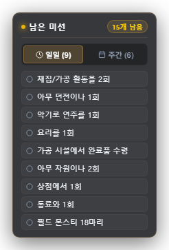
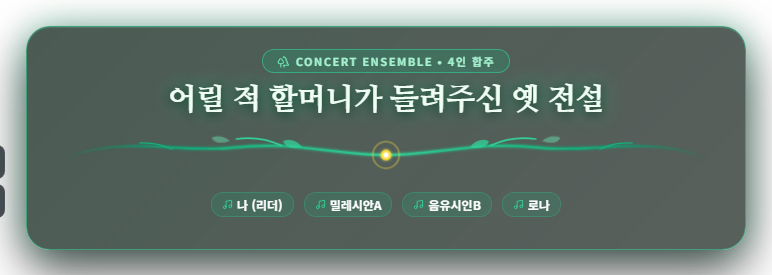
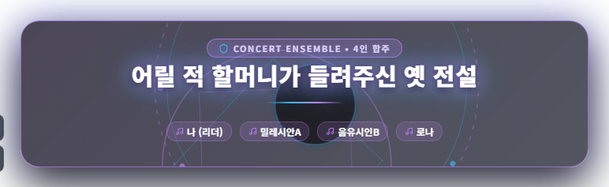
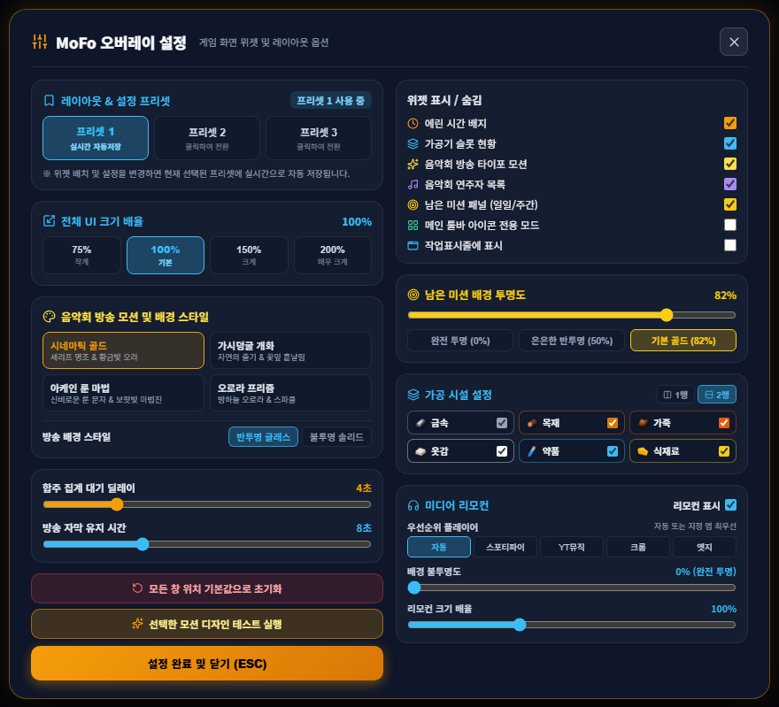

<div align="center">


# MoFo

**「瑪奇 M（Mabinogi Mobile）」資訊浮層（HUD）**

<sub><b>Mo</b>bi + In<b>Fo</b> — 遊戲維持原樣，只在上方顯示你需要的資訊。</sub>

<br>


[한국어](README.md) · [English](README.en.md) · [日本語](README.ja.md) · **繁體中文**

</div>

---

## 🎬 介紹影片

<div align="center">
  
  <br>
  <a href="docs/media/mofo-intro.mp4"><b>▶ 觀看完整有聲影片（mp4）</b></a>
  <br>
  <sub>※ 程式介面與影片皆為韓文。</sub>
</div>

---

## ✨ 功能

### 🕰️ 艾琳時間
以小徽章隨時顯示遊戲內的艾琳（Erinn）時間、天氣與你目前所在的位置。


### ⚒️ 製作狀態
即時倒數六座加工設施（金屬、木材、皮革、布料、藥品、料理）。完成的設施會泛起金光，可**一鍵領取**。可選擇兩列或單列版面。


### 📋 剩餘任務
只顯示尚未完成的每日與每週任務。



### 🎵 媒體遙控
不必離開遊戲，就能控制電腦上正在播放的音樂，支援 Spotify、YouTube Music、Chrome、Edge 等。可播放／暫停／上一首／下一首／調整音量。


### 🎻 演奏會轉播動畫
附近開始合奏時，MoFo 會先花幾秒鐘集合演奏同一份樂譜的所有人，再像轉播字幕一樣**只顯示一次**。提供四種主題可選。


<details>
<summary>查看全部四種主題</summary>

| **電影金** | **藤蔓綻放** |
|:---:|:---:|
|  |  |
| **奧術符文** | **極光稜鏡** |
|  |  |

</details>

### 🔎 原曲搜尋 <sup>NEW</sup>
選一份樂譜開始演奏，MoFo 會去掉樂譜標題中的 `[합주용]`、`#피아노` 等標籤，找出原曲，並且**只在確定比對無誤時才自動發到聊天視窗**。
使用 FLO、iTunes 與 Deezer 的公開搜尋，所以**不需要 API 金鑰，也完全免費。**
請在設定中開啟 **원곡 찾기（原曲搜尋）ON**。

### 🖱️ 不擋你的路
- **智慧穿透**：只有小工具會接收點擊，點在空白處的操作會直接傳給遊戲。
- **完全穿透（F8）**：所有點擊（包含小工具）都會傳給遊戲。
- **在小工具上連按兩下可隱藏 5 秒**；也可移動、鎖定、重設小工具位置。
- 最小化遊戲視窗時浮層會一併隱藏，還原後浮層就會回來。
- 可從系統匣圖示顯示或隱藏。

### ⚙️ 設定
三種版面預設（即時儲存）、介面縮放 75–200%、各小工具開關、合奏集合延遲、字幕顯示時間等。



---

## 🚀 開始使用

### 系統需求
- Windows 10 / 11（WebView2 執行階段）
- **瑪奇 M PC 版用戶端** — MoFo 透過遊戲隨附的 `MabinogiMobile_CLI.exe` 讀取遊戲資訊。程式會自動從執行中遊戲所在的資料夾尋找；找不到時請設定 `MABINOGI_CLI_PATH` 環境變數。
- 若要自行建置：[Node.js](https://nodejs.org/) 18+、[Rust](https://www.rust-lang.org/tools/install)

### 建置與執行

```bash
npm install
npm run tauri:dev     # run in development mode
npm run tauri:build   # build the executable → src-tauri/target/release/mofo.exe
```

遊戲上方會出現一個透明、無邊框、永遠置頂的視窗。

### 使用 OBS 錄影
本程式沒有擷取保護，因此顯示器擷取（OBS、GeForce Experience 等）會原樣錄下浮層。

<details>
<summary>網頁浮層模式（OBS 瀏覽器來源）</summary>

執行 `npm run dev`，並在 OBS 加入 `http://localhost:3002` 作為瀏覽器來源（1920×1080），即可疊成透明圖層。
此模式需要在 3001 連接埠另外執行 Mabinogi Bridge 伺服器，該伺服器不包含在本儲存庫中。

</details>

---

## 🧱 技術堆疊

| 領域 | 使用技術 |
|---|---|
| 應用程式外殼 | Tauri 2 (Rust) — 透明視窗、點擊穿透、系統匣、遊戲視窗追蹤 |
| UI | React 19 · TypeScript · Vite · Framer Motion |
| 媒體控制 | Windows Media Session API · 系統音量 |
| 歌曲搜尋 | FLO · iTunes · Deezer 公開搜尋 |

---

## ⚠️ 免責聲明

MoFo 是非官方的粉絲自製工具，與 NEXON 及瑪奇 M 無任何關聯。
遊戲名稱與商標歸其各自所有人所有。

## 📄 授權

[MIT](LICENSE)
